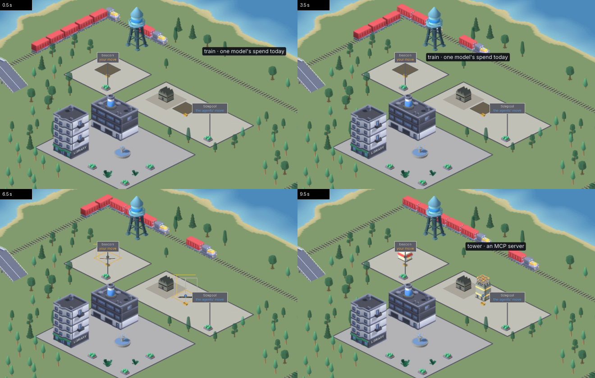

# 169. The city opens with every live session arriving by tug, so for its first seven seconds they are bare lots

**Open, in progress since 2026-10-20 in the session "item 169". Filed 2026-10-20 (r786), by the fresh-eyes audit, item 154. Nobody's call — a defect, for the next patch release (the manager, 2026-10-20).**

Depends on: nothing

`noteVoyages` (`botropolis/pkg/city/voyages.go`) promises that *"the first snapshot only takes note, so the city does not open with a fleet"*.
It does open with one.
Every session that is live when the city starts is treated as new: a tug sails it in for `SailFor` (6 s), its lot stays bare while it sails, then it is built over `BuildFor` (1.8 s), with fence, scaffolding and crane.

`hamlet`, 13:00, a ten-second clip at two frames a second through `make demo-media`: at 0.5 s and 3.5 s the working and waiting sessions are dark empty lots with a tug on the river, at 6.5 s they are building sites, and by 10 s their buildings stand.

## Why

`first := s.known == nil` decides whether a snapshot is the first.
But `SetSnapshot` runs before any snapshot has arrived: `(*Game).setStatsOn` calls `Scene.SetLedger` at start-up whenever statistics are on, which is the default, and `SetLedger` rebuilds with `s.SetSnapshot(s.snapshot)` — the scene's empty zero snapshot.
That pass sets `s.known` to an empty, non-nil map, so the real first snapshot is the second, and every session in it is an arrival.
`SetLadder` does the same when the configured thresholds differ from the scene's.
`noteDrones` uses the same `s.known == nil` test, so subagents already at work at start-up take off instead of being found on station.

## What it costs

- Every still the demo films shows the live sessions as empty lots: the website's frames, `layers/pressure.png`, `workshop/needs-you.png` — whose selected session, the subject of the shot, has no building — and the audit's own.
- Every opening of the city spends its first seven seconds sailing and building what was already there, which is the motion the map reserves for something actually happening.
- At night the glow of those sessions is drawn over the empty lots, which may be part of what item 74 sees.

## The fix

Decide "first" by whether a real snapshot has been seen — a flag set by the first `SetSnapshot` that does not come from the scene itself, or `known` left nil until the snapshot carries any session or a time — rather than by `known` being nil.
A test in `pkg/city`: a scene given a ledger, then a snapshot with live sessions, launches no voyages and no drones.
