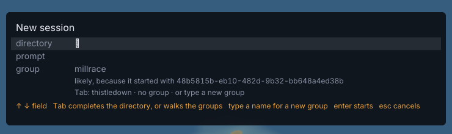

# 173. New session explains its group guess with a session id instead of a title

**Fixed 2026-10-20 (`af7edfa`, r817). Filed 2026-10-20 (r786), by the fresh-eyes audit, item 154. Nobody's call — a defect.**

Depends on: nothing

Opening New session (`shift+n`) on the `metropolis` demo city proposes a group, and gives its reason as:

```
group   millrace
        likely, because it started with 48b5815b-eb10-482d-9b32-bb648a4ed38b
```



Shot: `metropolis`, keys `shift+N`, 1920×1080; the crop is (590, 60)–(1330, 280).

`Reason.Describe` (`botropolis/pkg/group/name.go`) takes a function that turns a session id into its title, so the reason can name the session it matched.
`(*newSession).why` (`botropolis/pkg/render/newsession.go`) passes `func(id string) string { return id }`, so the reason names the raw id.
Everywhere else names the session by title: `status --json` gives the same group's reason as *"likely: started with Saltmarsh API"*.

The fix passes the title lookup the card and the board already use.
A test on `why` with a guess whose reason has a `With` should assert the title appears and the id does not.

## Fixed

`state.TitleOf` is the lookup `groupViews` used privately, now exported, and `(*newSession).why` passes it over the city's sessions instead of the identity.
So New session names the session as the board and `status --json` do: by its title, or by its short id when it has none or is not in the city.
`TestNewSession` in `botropolis/pkg/render/newsession_test.go` asserts the title appears and the id does not, and the short-id fallback.

Frames, `metropolis`, `shift+N`, the item's crop, approved by Aria on 2026-10-20: `botropolis/docs/screenshots/r786-item-173-new-session-before.png` names the session `55866aad-8efd-4b59-8e09-d3772f7c11a0`, and `botropolis/docs/screenshots/r817-item-173-new-session-after.png` names it *JSON output for the report*.
