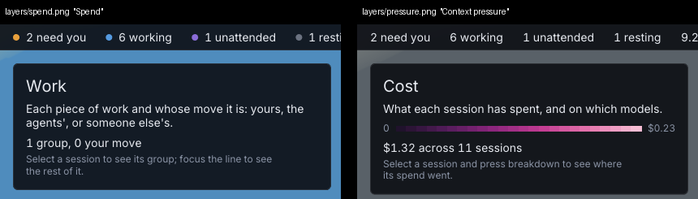

# 177. The demo's "Spend" and "Context pressure" stills show the Work and Cost lenses, and the website publishes them so

**Fixed 2026-10-20 (`b3de465`, r803). Filed 2026-10-20 (r786), by the fresh-eyes audit, item 154. Nobody's call — a defect.**

Depends on: nothing

`botropolis/demo/scenarios/layers.yaml` was written for the nine views.
Its stills press a digit and name what it used to show:

| shot | keys | titled | shows now |
| --- | --- | --- | --- |
| `spend` | `Digit2` | Spend, *"coloured by what each session has cost"* | the Work lens |
| `pressure` | `Digit3` | Context pressure, *"coloured by how full each session's context is"* | the Cost lens |

The six lenses are `city.Lenses` (`botropolis/pkg/city/lens.go`): Attention, Work, Cost, Capacity, Health, Connections.
The lens panel in each frame names the lens it shows, at (32, 76) in a 1920×1080 frame: *Work* in `layers/spend.png` and *Cost* in `layers/pressure.png`, both in `botropolis/dist/demo/` as filmed on 2026-10-19 and again by this audit.

The website lists both under the old titles: `botropolis.city/src/data/media.json` carries `layers/pressure` as "Context pressure" and `layers/spend` as "Spend".
The `views` clip's description still promises nine views by their old names — *"attention, spend, context pressure, staleness, servers, traffic, models, fan-out and health"* — and it is in the website's theatre (`src/data/theater.ts`).

The fix renames and re-keys the stills (Cost is `Digit3`; Capacity, `Digit4`, is the nearest to context pressure), rewrites the clip's description for the six, refilms, and re-imports the website's media.
The scenario test already resolves every key name; it could also hold each still's title to the lens its digit selects, so a reshuffle of the lenses fails `make test` instead of the website.

## Fixed

`b3de465` (r803) renames the stills and re-keys them: `cost` presses `Digit3` and is titled *Cost*, and `capacity` presses `Digit4` and is titled *Capacity*, each described by its lens's own sentence.
The `views` clip presses the six lens keys and no longer presses 7, 8 and 9, which selected nothing for 7.5 s of film.
It is 24.5 s long, titled *Six ways to read the city*, and names the six lenses.

`render.LensOfKey` reads the same `lensKeys` table the game's key handler does, and `TestDemoScenarios` uses it to fail a digit that selects no lens, a still not titled for the lens its key selects, and a clip whose description does not name each lens it presses.
All three were red against the old scenario.

Aria approved the refilmed stills on 2026-10-20: `botropolis/docs/screenshots/r799-item-177-cost.png` and `botropolis/docs/screenshots/r799-item-177-capacity.png`, committed in `b1b8ef0`.
They are named r799, the revision before main moved under the landing;
the code they show is r803.

The website was not edited: `make media-import` regenerates `media.json` from the film's manifest, so the release film carries the new titles, and the new shot names replace `layers/spend` and `layers/pressure` there.
There is no changelog line, since nothing in the app changed.
