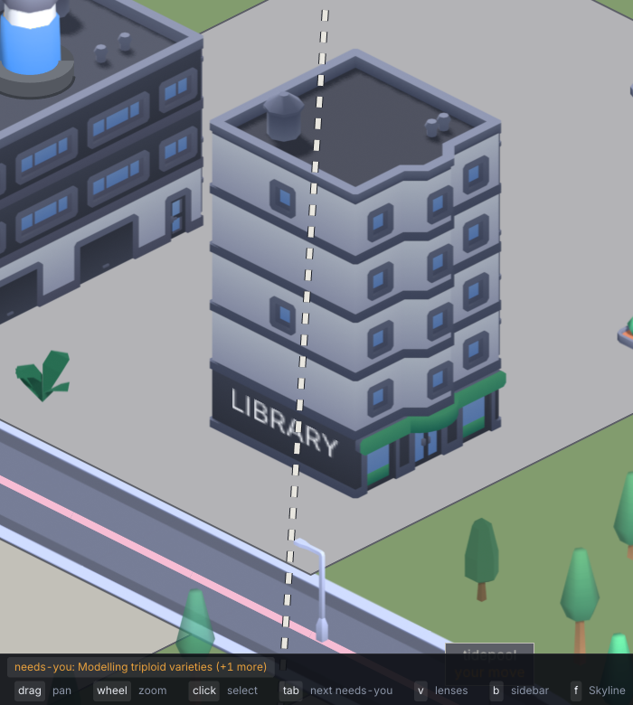

# 179. Group lines are drawn over the buildings they pass behind

**Open, in progress since 2026-10-20 in the session "item 179". Filed 2026-10-20 (r786), by the fresh-eyes audit, item 154, from its matters of taste, at Aria's request. Nobody's call.**

Depends on: nothing

A group's line runs across its districts as a dashed or solid stroke, and it is drawn after everything on the ground, so it crosses the front of any building in its way.
At closest zoom on the `layers` demo city, turned three times, a line runs down the library's facade from its roof, over the plaza and across the road.

Shot: `layers`, keys `R R R` and ten `Equal`, 13:00, 1920×1080; the crop is (0, 300)–(700, 1080).

`drawIso` (`botropolis/pkg/render/iso.go`) draws every layered item, then the night overlay and its lights, and only then `groupLines`, for the faded lines and again for the lit stations.
So a line is on top of every building and, at night, brighter than the overlay that darkens them.
Item 87 drew the lines as a transit map laid over the city, which may be why; but a line that cuts across a building's front reads as a wire strung through it, and it hides the windows and signs it crosses.

What it wants decided while fixing: whether the line goes into the depth sort as something on the ground, so buildings in front hide it, or stays on top and gives way where it crosses a building (a gap, or a fade under the footprint).
A test can hold a line's segment behind a building's footprint to being drawn before the building.
