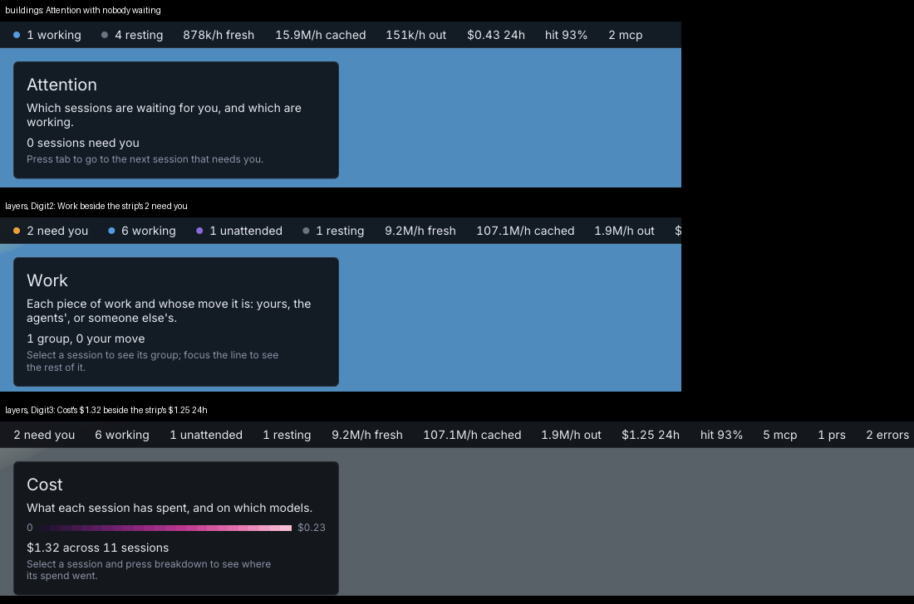

# 180. Three lens panels say things that read as wrong beside the strip

**Fixed 2026-10-20 (`e4bea15`, r827; `dce9c82`, r830). Filed 2026-10-20 (r786), by the fresh-eyes audit, item 154, from its matters of taste, at Aria's request. Nobody's call.**

Depends on: nothing
Landed: slice 1 (`e4bea15`, r827).

Each lens's panel, top left, carries a count and a hint, built in `botropolis/pkg/city/lens.go`.
Three of them read as wrong next to the strip above them, though each is right on its own terms.

Shots: `buildings` at fit; `layers` with `Digit2` and with `Digit3`; 1920×1080, crops of the top-left corner.

- **Attention, with nobody waiting**, says *"0 sessions need you"* and then *"Press tab to go to the next session that needs you."*
  The hint is fixed: `hint` returns it for Attention whatever the count. With none waiting it points at something that is not there; it could say so, or say what tab will do.
- **Work** says *"1 group, 0 your move"* while the strip says *2 need you*.
  The panel counts groups whose move is yours (`s.snapshot.Groups`, `MoveYours`); the strip counts sessions. Two sessions waiting outside any group make it read as a contradiction.
- **Cost** says *"$1.32 across 11 sessions"* while the strip says *$1.25 24h*.
  The panel sums what each card says its session spent (`spend()`, the high end of a priced range), over each session's whole life; the strip is the last 24 hours. Neither says which window it is beside the other.

The fix is wording: Attention's hint follows its count, Work says what it counts ("0 groups waiting on you"), and Cost names its window ("$1.32 over these sessions' lives") and whether it is a range.
The lens tests already pin each count's text, so each change is a test changed first.

## Closed

Fixed in `e4bea15` (r827) and `dce9c82` (r830), with the wording the manager settled for Aria on 2026-10-20, and the frame approved by her the same day: `botropolis/docs/screenshots/r827-item-180-lens-panels.png`.

- **Attention**: with nobody waiting, its hint says *"Nobody is waiting on you; tab finds the next one when someone is."*, and tab itself says *"nobody needs you right now"* instead of *"nothing is needs-you"*.
- **Work** counts groups in the cards' own words: *"0 of 1 group is your move"*, *"1 of 2 groups are your move"*, and *"no groups yet"* with none.
  The district signs saying *your move* beside *"0 of 1 group is your move"* are right, and were left: they are per district, lit by waiting sessions outside the group.
- **Cost** names its window: *"$1.32 across 11 sessions, since they started"*, with *"up to"* in front when any session's spend is a priced range.

Beyond what the item asked, at the manager's request: tab's jump said *"needs-you: <title>"*, and so did the footer's waiting line, though the request took the footer to say *"needs you"* already.
Both now come from `city.JumpedTo` and say *"needs you: <title>"*.

The tests are `pkg/city/lenswords_test.go`, and the acceptance pin on the footer in `testing/acceptance/answer_test.go`.
