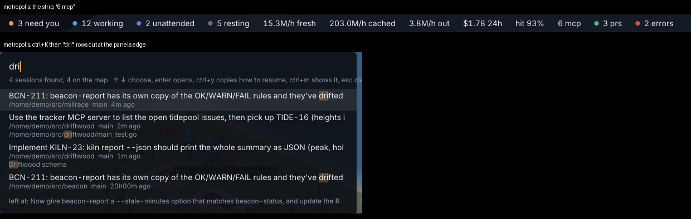

# 181. Small polish: "6 mcp" counts calls, `f` and `0` are listed as two keys, `status` prints full model ids, and finder rows are cut with no ellipsis

**Open, in progress since 2026-10-24 in the session "item 181". Filed 2026-10-20 (r786), by the fresh-eyes audit, item 154, from its matters of taste, at Aria's request. Nobody's call.**

Depends on: nothing

Four small things, each a line or two, filed together because none is worth an item alone.

Shots: `metropolis` at fit, its strip; `metropolis` with `ctrl+K` and `dri` typed, the finder at (640, 180)–(1290, 470); 1920×1080.

1. **"6 mcp" is a count of calls.**
   `StripChips` (`botropolis/pkg/ui/strip.go`) writes `fmt.Sprintf("%d mcp", s.MCPCalls)`, which beside a map of radio towers reads as six servers. The `metropolis` city has two. *"6 mcp calls"* says what it is.
2. **`f` and `0` are listed as two actions.**
   The reference (`bindings`, `botropolis/pkg/render/keys.go`) has `f` as *Skyline* and `0` as *reset the view*, and the code sends `f`, `0` and keypad `0` all to `Scene.Fit`. One row, *"f or 0: Skyline, the whole city"*, says it once.
3. **`status` prints full model ids**: `claude-haiku-4-5-20251001` widens the MODEL column for every row (`botropolis/pkg/commands/status.go`). The city already says models short; the table could use the same short name, keeping the full id in `--json`.
4. **Finder rows are cut at the panel's edge with no ellipsis.**
   A long prompt, path or title runs to the panel's right edge and stops mid-word (*"…pick up TIDE-16 (heights i"*), so the row reads as broken rather than shortened. The finder's rows want the same clip-with-`…` the card and the sidebar use.

## Answered while building

- **Which short model name** (manager, 2026-10-24): `format.Model(id)`, which drops `claude-` and a trailing `-YYYYMMDD` (`claude-haiku-4-5-20251001` → `haiku-4-5`) and leaves any other id as it is; the city's power mix (`mixName`) switches to it too, since this item says the table should use the name the city uses, and the city's only dropped the prefix. `--json` keeps the full id.
- **The test tree** (manager, 2026-10-24): approved as sent, one slice.
