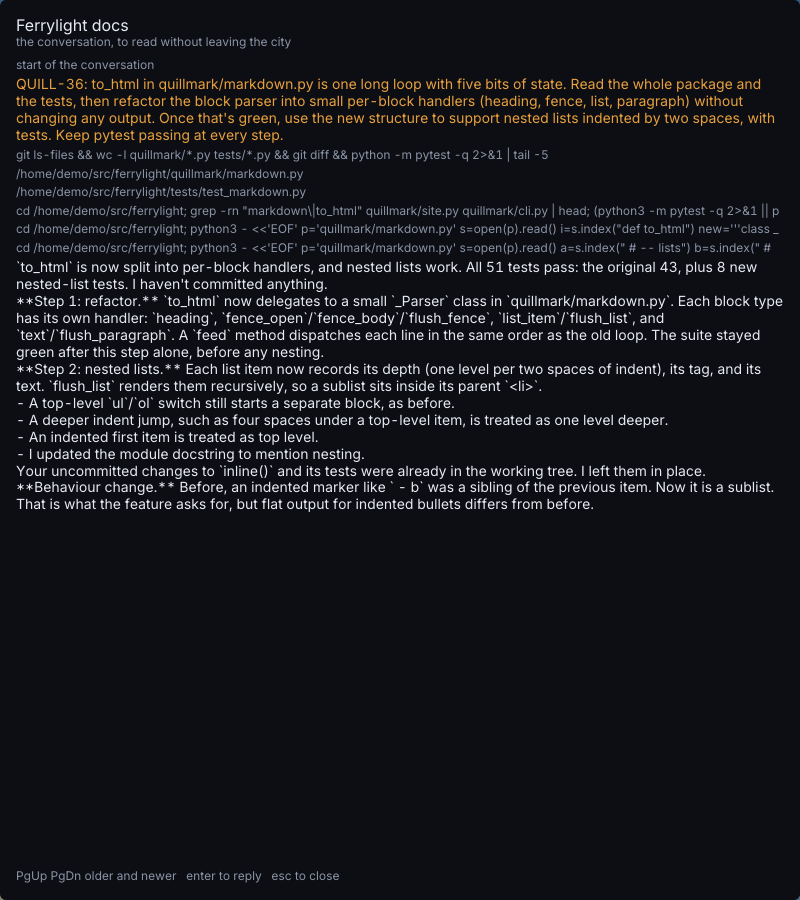

# 182. The reading pane shows Claude's Markdown as raw text

**Open, in progress since 2026-10-20 in the session "item 182". Filed 2026-10-20 (r786), by the fresh-eyes audit, item 154, from its matters of taste, at Aria's request. Nobody's call.**

Depends on: nothing
Landed: slice 1 (`a170852`, r826).

The reading pane (`o`, or *read* on a card) shows a session's conversation without leaving the city.
Claude's replies are Markdown, and the pane prints them as typed: `**Step 1: refactor.**` with its asterisks, `` `to_html` `` with its backticks, and list markers as plain hyphens.

Shot: `metropolis`, keys `Tab O`, 1920×1080; the crop is (560, 90)–(1360, 990), the pane on *Ferrylight docs*.

The pane is laid out by `ui.ReaderPanel` and drawn by `(*reader).draw` (`botropolis/pkg/render/reader.go`), which wrap each line of text and set it in one face.
Nothing between the transcript and the pane reads Markdown.

What a fix could be, smallest first: strip the markup that only decorates (`**`, `__`, backticks around a word) so the prose reads cleanly; then bold and code faces for those spans, which the city does not ship yet; then lists and headings laid out as such.
Code blocks would want a monospace face too.
A test on the wrapping can hold a reply with `**bold**` and `` `code` `` to producing no asterisks or backticks in the laid-out lines.

**Decided with the manager, 2026-10-20.**
Replies are parsed with goldmark (`github.com/yuin/goldmark`, MIT), client-only, so `botropolisd`'s dependency graph is untouched.
The monospace face is Go Mono, from `golang.org/x/image/font/gofont/gomono` (BSD-3, Bigelow & Holmes), its licence beside it in `pkg/assets/fonts/` and its thanks in the README.
Bold comes from Inter's own weight axis; emphasis stays upright, because the variable file has no italic axis.
Beyond the item's own list, Claude writes these often enough to handle: GFM tables, laid out as a monospace block with aligned columns and clipped like code; blockquotes, as an indented block without the marker; a horizontal rule as a block of its own; raw HTML shown as text, never interpreted; and links showing their text, then the URL in parentheses when it differs.
Only Claude's replies are read as Markdown: your prompts and tool calls stay as typed.
Two slices: the first reads the Markdown and lays it out in the one face; the second draws bold and monospace.
