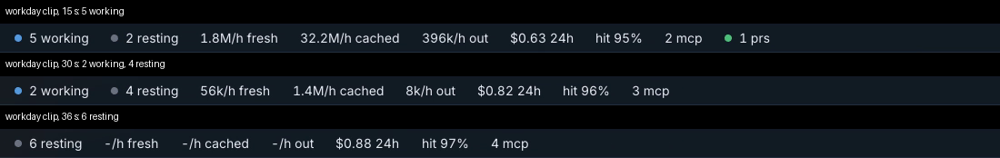

# 187. A demo clip that takes more than an hour to film loses its live sessions partway through

**Fixed 2026-10-23 (`74e16ec`, r966). Filed 2026-10-20 (r786), by the fresh-eyes audit, item 154, from its motion clips. Nobody's call — a defect.**

Depends on: nothing

`botropolis-demo film` stands in for each live session with a detached `sleep` whose pid answers, because the city decides a session is live by whether its pid does.
`Filmer` gives every stand-in a fixed hold of one hour of wall-clock time (`Sleepers(home, time.Hour)` in `botropolis/pkg/demo/film.go`).
The clip's own timeline runs in video time, frame by frame, so a clip that takes longer than an hour to film outlives its stand-ins: each sleep exits, the city sees its session's pid gone, and the session turns resting mid-clip, whatever the scenario says.

The audit filmed `workday`'s timeline (40 s, at 3 frames a second) on a machine with a load of about 178 on 14 cores; it took 1 h 39 min.
The three sessions staged at the start were placed about 1 h 22 min into the run, so their stand-ins exited around frame 58, 19 seconds into the clip.
From there the strip reads *2 working, 4 resting* at 30 s and *6 resting* at 36 s, where the scenario has one session needing you and three or four working; the tidepool session's change to needs-you at 24 s never shows, because its process is already gone.

At 30 frames a second and no other load, a clip films in minutes and this never shows, which is why the shipped clips are right.
It shows when the machine is busy, which is exactly when item sessions film side by side, and it makes the footage wrong silently: nothing fails, and the encoded clip looks plausible.

The fix sizes the hold from the work, not the clock — the stand-ins are unstaged at the end of each shot anyway, so the hold can be long (a day), or the director can renew them.
A test: a `Filmer` with a fake clock that advances past an hour between frames keeps every placed session live until its `leave`.

## Closed

Fixed in `74e16ec` (r966): `Filmer` holds each shot's stand-ins for `filmHold`, a day, and `TestFilmHold` in `botropolis/pkg/demo/film_test.go` holds that above the slowest film measured, this item's 1 h 39 min.
It was red at the old hour and green at a day.
The fake-clock test was not written: a stand-in is a real `sleep`, so its life is wall-clock time and no clock on `Filmer` reaches it, and a fake spawner that modelled expiry would only restate the constant.
`botropolis-demo stage --hold` keeps its default of an hour, because it is for a recording made after the stager exits, and whoever runs it sets it.
Tying the stand-ins to the filmer's own lifetime, so that no hold exists at all, was rejected for now: `Pdeathsig` fires when the OS thread that forked the child exits, not the process, and the Go runtime can retire that thread (golang/go#27505), while a stand-in that waits on a pipe instead changes the process the city sees.
